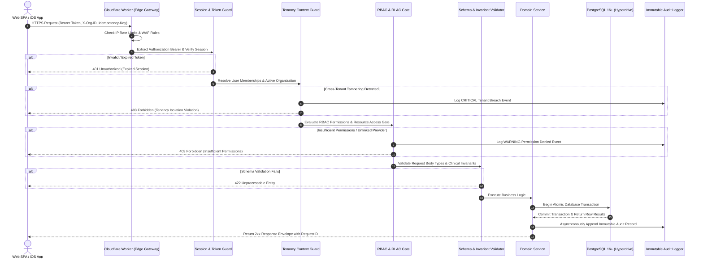

# CLINILYNC API Architecture & Standards

## 1. Design Philosophy

The CLINILYNC API (`/api/v1/*`) is a RESTful, stateless, client-independent interface. It serves the React SPA, future native Swift/SwiftUI iOS applications, and trusted external healthcare integrations without client-specific behavior.

---

## 2. API Versioning Strategy

- **URI Versioning:** All endpoints are strictly prefixed with `/api/v1/`.
- **Breaking Changes Policy:** An increment to `/api/v2/` occurs *only* when breaking data structures or fundamental authentication handshakes change. Additive fields (new attributes in JSON responses) do not break clients and remain within `/api/v1/`.
- **Deprecation Lifecycle:** Deprecated endpoints return the `Deprecation: true` and `Sunset: <date>` HTTP headers, maintaining backward compatibility for a minimum of 180 days.

---

## 3. Standard Request & Response Envelopes

### 3.1 Standard Success Envelope
All successful 2xx responses return a structured JSON object containing `data` and optional `meta`:

```json
{
  "data": {
    "id": "c1f7b029-4c6e-4c3e-8c34-7c2a792d04a1",
    "mrn": "MRN-90421",
    "firstName": "David",
    "lastName": "Miller",
    "status": "ACTIVE"
  },
  "meta": {
    "requestId": "req_8f1a23e981",
    "timestamp": "2026-10-08T17:30:00.000Z"
  }
}
```

### 3.2 Standard List & Pagination Envelope
Lists return items inside `data` array with explicit pagination metadata:

```json
{
  "data": [
    { "id": "...", "title": "..." }
  ],
  "meta": {
    "requestId": "req_8f1a23e982",
    "timestamp": "2026-10-08T17:30:00.000Z",
    "pagination": {
      "limit": 20,
      "total": 142,
      "cursor": "eyJpZCI6ImFwdF8xMDEiLCJ0cyI6MTcyODQwODAwMH0=",
      "hasMore": true
    }
  }
}
```

### 3.3 Standard Error Envelope
All error responses (4xx, 5xx) follow an RFC 7807-inspired schema. Stack traces and raw SQL errors are strictly prohibited in production:

```json
{
  "error": {
    "code": "FORBIDDEN_RESOURCE_ACCESS",
    "message": "User does not have clinical authorization to access this patient's medical records",
    "status": 403,
    "requestId": "req_8f1a23e983",
    "timestamp": "2026-10-08T17:30:00.000Z",
    "details": [
      {
        "field": "patientId",
        "issue": "Patient belongs to a different organizational partition or restricted program"
      }
    ]
  }
}
```

---

## 4. HTTP Status Code Contract

| Status Code | Standard Usage in CLINILYNC |
| :--- | :--- |
| **200 OK** | Resource retrieved successfully, query completed, or synchronous mutation applied. |
| **201 Created** | New resource successfully created and persisted (e.g., patient intake, prescription signed). |
| **202 Accepted** | Request accepted for asynchronous background processing (e.g., bulk report export, insurance EDI claim batch). |
| **204 No Content** | Action completed successfully with no response body (e.g., session logout). |
| **400 Bad Request** | Malformed JSON payload or syntactic validation failure. |
| **401 Unauthorized** | Missing, expired, or cryptographically invalid session token. |
| **403 Forbidden** | Authenticated user lacks permission, violates tenancy isolation, or fails resource-level access check. |
| **404 Not Found** | Resource does not exist within the active organization scope (prevents information disclosure). |
| **409 Conflict** | Concurrency conflict (e.g., appointment time slot already booked, double-payment race condition). |
| **422 Unprocessable** | Syntactically valid JSON that violates semantic domain invariants (e.g., negative invoice price, invalid ICD-10 code). |
| **429 Too Many Requests**| Rate limit threshold exceeded on token-bucket counter. |
| **500 Internal Error**| Unexpected internal failure. Generic sanitized error returned to client; full trace recorded internally with `requestId`. |

---

## 5. API Request Lifecycle



---

## 6. Pagination & Filtering Standards

### 6.1 Cursor vs Offset Pagination
- **Cursor-Based Pagination (Default for time-series and high-volume lists):** Used on `encounters`, `audit_logs`, `messages`, `vitals`, and `invoices`.  
  Query params: `?cursor=<base64_encoded_token>&limit=20` (max limit 100).  
  *Prevents page drift when new clinical records or messages are inserted concurrently.*
- **Keyset / Offset Pagination (Administrative grids):** Used on user lists and service catalog tables: `?page=1&limit=25`.

### 6.2 Safe Attribute Filtering
Arbitrary SQL or client-defined query clauses are strictly prohibited. Endpoints accept only whitelisted query parameters:
- Patients: `?status=ACTIVE&search=Miller&dob=1984-06-14`
- Appointments: `?start=2026-10-08T00:00:00Z&end=2026-10-08T23:59:59Z&providerId=...&status=CHECKED_IN`
- Invoices: `?status=ISSUED&patientId=...&dueBefore=2026-11-01`

---

## 7. Idempotency Contract

For non-idempotent mutation operations (`POST /api/v1/billing/invoices`, `POST /api/v1/billing/payments`, `POST /api/v1/appointments`), clients may send an `Idempotency-Key: <UUID>` header.
- The server records the idempotency key in PostgreSQL or fast key-value storage with a 24-hour expiration.
- If a duplicate request with the identical key arrives within 24 hours, the server replays the original cached response without re-executing transactions.
