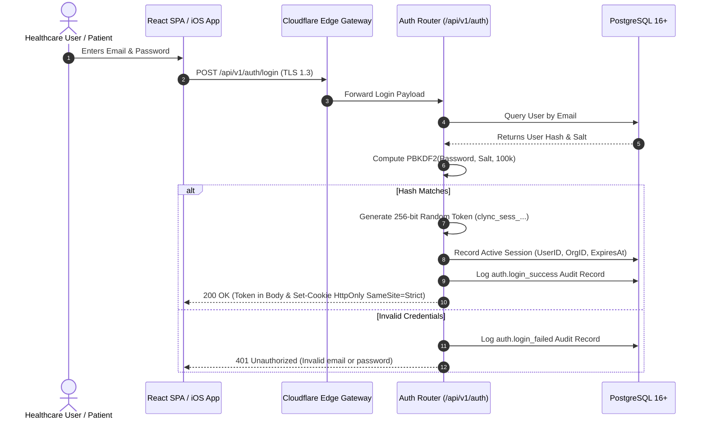

# CLINILYNC Authentication Architecture

## 1. Overview & Cloudflare Compatibility

CLINILYNC implements a high-security session architecture designed for healthcare platforms. It operates natively across Cloudflare Workers edge nodes and regional API services using the standard Web Crypto API (`crypto.subtle`) and PostgreSQL.

---

## 2. Authentication Strategy Evaluation

### 2.1 State-Bearing Sessions vs Stateless JWTs in Healthcare
| Dimension | Stateless JWT | Opaque Cryptographic Sessions (CLINILYNC Chosen Architecture) |
| :--- | :--- | :--- |
| **Instant Revocation** | Difficult without distributed blacklists | **Immediate** upon session deletion in database / KV |
| **Idle Timeout Enforcement** | Cannot enforce sliding 30-min idle timeouts cleanly | **Native** sliding expiration on activity |
| **Stolen Token Risk** | Valid until fixed expiration (e.g. 1 hour) | **Invalidated immediately** on suspicious activity |
| **PHI / Role Desync** | Token claims become stale when permissions change | **Always fresh** authorization context |
| **Verdict** | *Rejected for clinical PHI access* | **Adopted as primary standard** |

---

## 3. Credential & Password Security

1. **Algorithm:** PBKDF2 with HMAC-SHA-256.
2. **Parameters:**
   - Iterations: $100,000$ minimum.
   - Salt: 16 bytes of cryptographically secure pseudo-random bytes (`crypto.getRandomValues`).
   - Derived Key Length: 64 bytes (512 bits).
3. **Constant-Time Verification:** Byte comparison executed in constant time (`crypto.timingSafeEqual`) to prevent timing side-channel attacks.
4. **Zero Client Secrets:** Plaintext passwords, hashes, and salts are never emitted to client applications or logs.

---

## 4. Session Lifecycle & Token Management

### 4.1 Token Expiration Windows
- **Shift Lifetime:** 8 hours maximum session lifetime.
- **Idle Inactivity Timeout:** 30 minutes of inactivity revokes session automatically, enforcing regulatory compliance for clinical workstations.
- **Sliding Expiration:** Authenticated interactions slide the idle activity timer forward up to the 8-hour maximum shift cap.

---

## 5. Multi-Factor Authentication (MFA) Foundation

The user entity and session schema are architected for two-factor authentication:
1. **Primary Gate:** Email + Password verified → If `mfa_enabled = TRUE`, session issues a short-lived (5-minute) intermediate token `mfa_pending`.
2. **Secondary Gate (`POST /api/v1/auth/mfa/verify`):**
   - RFC 6238 TOTP (Google Authenticator, Microsoft Authenticator).
   - FIDO2 / WebAuthn biometrics (TouchID / FaceID on iOS and hardware security keys).
3. **Session Promotion:** Upon successful secondary verification, the session is elevated to a fully authorized clinical session.

---

## 6. Password Reset & Account Recovery

- Reset tokens generated using 32 bytes of cryptographic entropy (`crypto.getRandomValues`).
- Stored as SHA-256 hashes in `password_reset_tokens` with a strict 15-minute expiration.
- Single-use policy: Verifying a token marks it as consumed and automatically invalidates all existing active sessions for that user across all devices.
