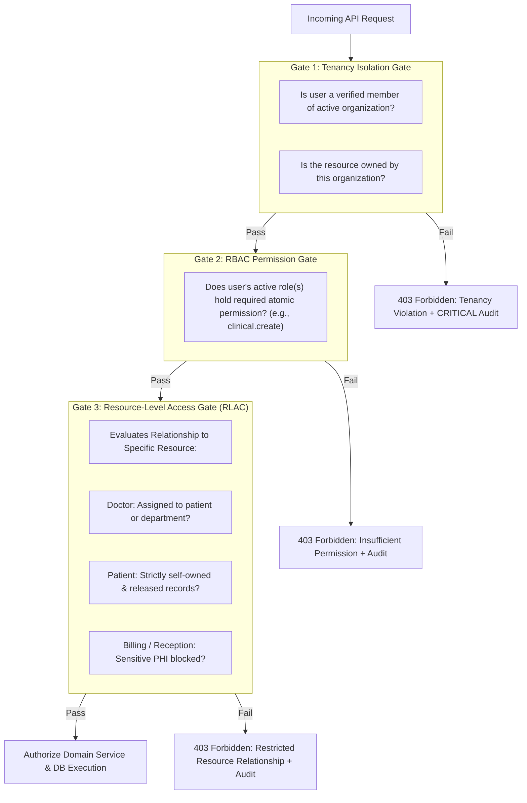

# CLINILYNC Authorization Architecture

## 1. Core Architectural Principle

**The frontend is never a security boundary.**  
Hiding UI buttons, navigation links, or routes in React or Swift is an ergonomics feature, not an authorization boundary. Every single API request must independently evaluate authorization at the backend before accessing or mutating data.

---

## 2. Multi-Gate Authorization Model

Authorization in CLINILYNC requires passing through THREE consecutive evaluation gates:



---

## 3. Why Role Alone Is Not Sufficient

In healthcare systems, checking `if (role === 'DOCTOR')` is dangerously insufficient:
1. **Tenancy:** A doctor at St. Jude Hospital must never access a patient at Metro Health Clinic.
2. **Clinical Scope:** A dermatologist in an outpatient clinic should not casually browse psychiatric consultation records unless explicitly referred or treating the patient.
3. **Departmental Separation:** Billing staff have legitimate access to patient names and invoices, but must be strictly blocked from viewing confidential psychotherapy notes or clinical SOAP details.
4. **Patient Portal Self-Service:** A patient has the `patient.view` and `appointment.view` capabilities, but must strictly be restricted to their *own* patient ID and records that have been signed off and *released* by an attending clinician.

---

## 4. Centralized Authorization Service Contract

Authorization logic is centralized in `backend/security/rbac.ts` and `backend/security/resource-access.ts`:

```typescript
export interface AuthorizationRequest {
  actor: {
    userId: string;
    organizationId: string;
    roles: Role[];
    permissions: string[];
    isSuperAdmin: boolean;
  };
  requiredPermission: string;
  resource: {
    type: 'Patient' | 'ClinicalRecord' | 'Encounter' | 'Prescription' | 'Invoice';
    id: string;
    organizationId: string;
    patientId?: string;
    providerId?: string;
    isReleasedToPatient?: boolean;
  };
}

export class AuthorizationService {
  static authorize(req: AuthorizationRequest): void {
    // 1. Tenancy boundary
    if (!req.actor.isSuperAdmin && req.actor.organizationId !== req.resource.organizationId) {
      throw new AuthorizationError('FORBIDDEN_TENANT_ISOLATION', 403);
    }

    // 2. RBAC capability check
    if (!req.actor.isSuperAdmin && !req.actor.permissions.includes(req.requiredPermission)) {
      throw new AuthorizationError('FORBIDDEN_PERMISSION_DENIED', 403);
    }

    // 3. Resource relationship check
    ResourceAccessGate.assertRelationship(req.actor, req.resource);
  }
}
```

---

## 5. Clinical vs Administrative Privilege Separation

| Persona / Role | Demographics | Appointments | Clinical SOAP Notes | Prescriptions | Lab Orders & Results | Invoices & Payments | System Settings |
| :--- | :--- | :--- | :--- | :--- | :--- | :--- | :--- |
| **Doctor / Clinician** | View, Update | View, Create, Complete | Author, Sign, Amend | Author, Sign, Cancel | Order, Review | View (fees) | None |
| **Triage Nurse** | View, Update | View, Check-in | Record Vitals, View | View active Rx | View, Collect Specimen | None | None |
| **Receptionist** | View, Create | View, Create, Check-in | **BLOCKED** | **BLOCKED** | **BLOCKED** | Collect Payment | None |
| **Billing Specialist**| View Demographics| View Schedules | **BLOCKED** | **BLOCKED** | View billable test codes | Full CRUD | None |
| **Patient** | View/Update Self | View/Book Self | View Released Only | View Active Self | View Verified Only | View/Pay Self | None |
| **Platform SuperAdmin**| Manage Tenant | None | **BLOCKED (Except audited break-glass)** | **BLOCKED** | **BLOCKED** | High-level metrics | Platform Only |

---

## 6. Platform Super Admin Constraints

Platform Super Administrators oversee platform health, database maintenance, and tenant provisioning. However, to maintain HIPAA and GDPR compliance, **Platform Super Admins are prohibited from unrestricted casual browsing of patient PHI**:
- Administrative routes (`/api/v1/admin/*`) permit viewing user rosters and system metrics.
- Direct clinical queries (`/api/v1/clinical/*`) require explicit, time-bounded, cryptographically audited **"Break-Glass Emergency Access"** that alerts the clinic's Data Protection Officer (DPO) and Lead Clinical Director immediately.
