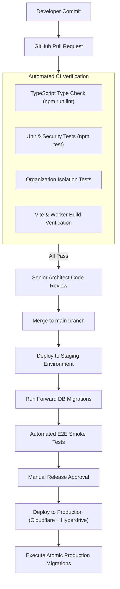

# CLINILYNC Deployment & Infrastructure Architecture

## 1. CI/CD Deployment Pipeline

---

## 2. Environment Strategy

| Environment | Purpose | Database | Edge Host | Secrets Management |
| :--- | :--- | :--- | :--- | :--- |
| **Development** | Local feature implementation & testing | Isolated local PostgreSQL / test fixtures | `localhost:3000` | `.env.local` (Never committed) |
| **Staging** | Pre-release regression testing & QA | Dedicated managed staging database | `staging.clinilync.com` | Cloudflare Staging Secrets |
| **Production** | Live clinical operations | Production PostgreSQL cluster with HA replica | `clinilync.com` | Cloudflare Production Secrets |

---

## 3. Cloudflare & PostgreSQL Connectivity Architecture

### 3.1 Edge Connection Management
Serverless edge runtimes (Cloudflare Workers) establish short-lived execution contexts that can exhaust PostgreSQL connection limits if connecting directly without pooling. CLINILYNC uses **Cloudflare Hyperdrive**:
- **Connection Pooling at the Edge:** Hyperdrive maintains a global pooled connection cache to PostgreSQL over TLS.
- **Latency Acceleration:** Re-uses established TCP handshakes and TLS sessions, reducing query latency from distributed edge nodes to under 40ms.
- **Transaction Safety:** Hyperdrive transparently supports standard PostgreSQL transaction statements (`BEGIN ... COMMIT ... ROLLBACK`).

---

## 4. Backup & Disaster Recovery Architecture

- **Automated Continuous Backups:** Daily full snapshots + Continuous Write-Ahead Log (WAL) archiving for **Point-in-Time Recovery (PITR)** up to 35 days.
- **Recovery Point Objective (RPO):** $\le 5$ minutes of data loss maximum in catastrophic regional failure.
- **Recovery Time Objective (RTO):** $\le 30$ minutes to failover to a hot standby replica in a secondary region.
- **Restore Verification Drills:** Bi-annual automated recovery drills restoring WAL archives into isolated sandboxes to verify data integrity.
