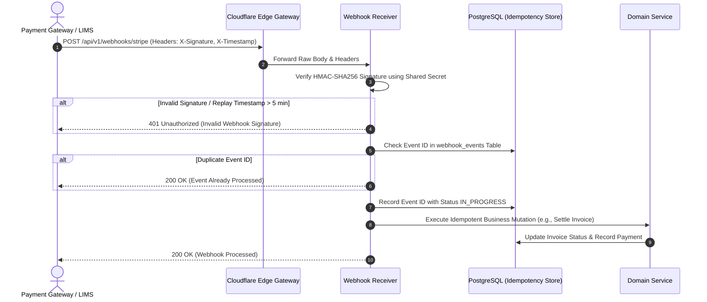

# CLINILYNC External Integration Architecture

## 1. Architectural Boundary Principles

External healthcare and infrastructure vendors must never be tightly coupled to the core domain services. All 3rd-party services connect through **Adapter / Gateway Interfaces** that isolate vendor-specific protocols, schemas, and credentials behind CLINILYNC domain abstractions.

---

## 2. Integration Adapters Overview

```
┌─────────────────────────────────────────────────────────────┐
│                   CLINILYNC Core Domain                     │
└──────────────┬──────────────┬──────────────┬────────────────┘
               │              │              │
       ┌───────▼──────┐┌──────▼───────┐┌─────▼────────┐
       │ EmailGateway ││ PayGateway   ││ LabInterface │
       └───────┬──────┘└──────┬───────┘└─────┬────────┘
               │              │              │
       ┌───────▼──────┐┌──────▼───────┐┌─────▼────────┐
       │ Resend / SES ││ Stripe / Bank││ External LIMS│
       └──────────────┘└──────────────┘└──────────────┘
```

### 2.1 Communication Gateways
- **Email Gateway (`EmailService`):** Transactional delivery for appointment confirmations, secure portal invites, and invoice receipts.
- **SMS / Telephony Gateway (`SmsService`):** Appointment reminders and urgent critical lab notifications via localized telecom providers.
- **Push Notification Service (`PushNotificationService`):** Apple APNs for native Swift/SwiftUI iOS app and Google FCM for Android.

### 2.2 Payment Processors
- **Payment Gateway Adapter (`PaymentGateway`):** Tokenized PCI-DSS compliant credit card transactions, direct debit, and local bank transfers. Plaintext card numbers never touch CLINILYNC servers.

---

## 3. Webhook Architecture & Security Contract

External payment providers, tele-health services, and external labs notify CLINILYNC via incoming webhooks under `/api/v1/webhooks/*`.

### 3.1 Webhook Verification Protocol


1. **HMAC Signature Verification:** Verifies the cryptographic digest of the raw incoming request body against a configured secret.
2. **Replay Attack Mitigation:** Verifies that request timestamp is within a 300-second window of server time.
3. **Idempotency Guarantee:** Duplicate webhook deliveries are detected via the provider's unique event ID (`webhook_events` table).

---

## 4. Healthcare Interoperability & FHIR Foundation

CLINILYNC does not force immediate heavy HL7 FHIR v4 serialization on internal APIs, but structures its internal relational schema to map 1:1 with FHIR Resource models:

| CLINILYNC Domain Entity | HL7 FHIR v4 Equivalent Resource | Key Harmonized Attributes |
| :--- | :--- | :--- |
| `patients` | `Patient` | `identifier` (MRN), `name`, `birthDate`, `gender` |
| `providers` | `Practitioner` / `PractitionerRole` | `identifier` (License), `specialty`, `organization` |
| `encounters` | `Encounter` | `class` (Ambulatory), `status`, `period`, `subject` |
| `clinical_notes` | `DocumentReference` / `Composition` | `type` (SOAP), `author`, `date`, `section` |
| `diagnoses` | `Condition` | `code` (ICD-10, SNOMED), `clinicalStatus`, `onset` |
| `allergies` | `AllergyIntolerance` | `code`, `category`, `criticality`, `reaction` |
| `vitals` | `Observation` | `code` (LOINC), `valueQuantity`, `effectiveDateTime` |
| `prescriptions` | `MedicationRequest` | `medicationCodeableConcept`, `dosageInstruction` |
| `lab_orders` | `ServiceRequest` | `code` (LOINC), `intent`, `priority` |
| `lab_results` | `DiagnosticReport` / `Observation` | `code`, `valueQuantity`, `interpretation` |
| `invoices` | `Invoice` / `Claim` | `total`, `lineItem`, `recipient` |

This alignment ensures future SMART-on-FHIR applications, hospital EHR bridges, and national health data exchanges integrate seamlessly without altering core tables.
