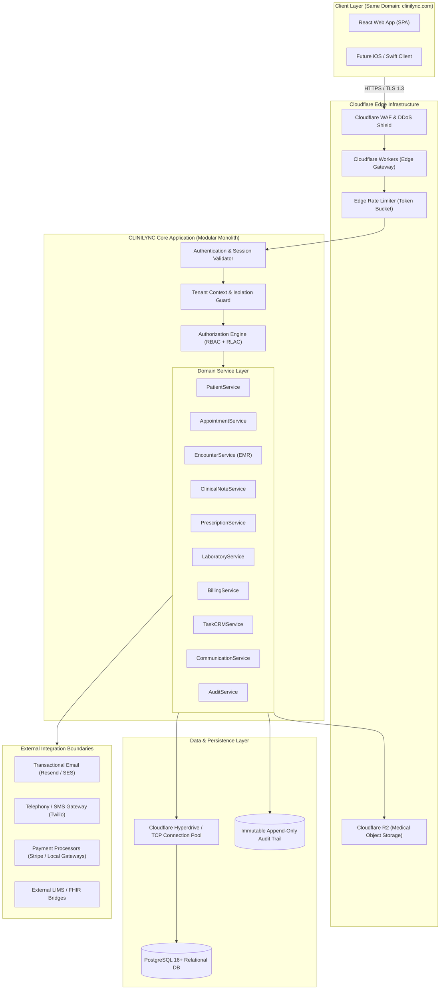

# CLINILYNC System Architecture Specification

## 1. Executive Overview

**Product:** CLINILYNC  
**Tagline:** *Connecting Healthcare. Simplifying Care.*  
**Primary Domain:** `clinilync.com`  

CLINILYNC is an enterprise healthcare CRM, lightweight Electronic Medical Record (EMR), and patient management platform designed for global multi-organization use. This document defines the end-to-end system topology connecting clients, edge infrastructure, domain services, database engines, and external integration boundaries.

---

## 2. Global System Topology

---

## 3. Core Architectural Principles

1. **Modular Monolith over Microservices:**  
   CLINILYNC is intentionally architected as a clean modular monolith. Distributed microservices introduce network latency, distributed transactions (two-phase commit failures), and operational overhead that jeopardize clinical data consistency. Modules share a single PostgreSQL engine with strict schema boundaries, communicating via in-process domain interfaces. Future scale extraction is possible without rewrites.
2. **Unified Single-Domain Architecture:**  
   All clients operate under `clinilync.com`:
   - `/` — Platform Landing
   - `/login` — Unified Authentication Portal
   - `/app/*` — Staff Healthcare Operations (CRM, EMR, Billing, Appointments)
   - `/admin/*` — Organization Administration & Audit Viewer
   - `/patient/*` — Patient Self-Service Portal
   - `/api/v1/*` — Versioned REST API
3. **Independent Security Boundary:**  
   The frontend is purely a presentation layer. React never enforces security; every HTTP request is authenticated, authorized, and validated independently at the edge and application server before reaching domain services.
4. **Zero Regional Bias:**  
   PostgreSQL schema, business rules, and API endpoints support arbitrary IANA timezones, ISO-4217 currencies, and global medical coding taxonomies (ICD-10, ICD-11, SNOMED-CT, LOINC, RxNorm).
