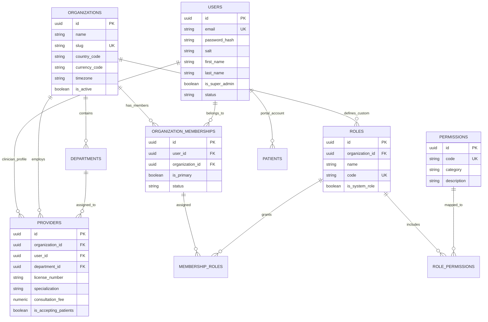
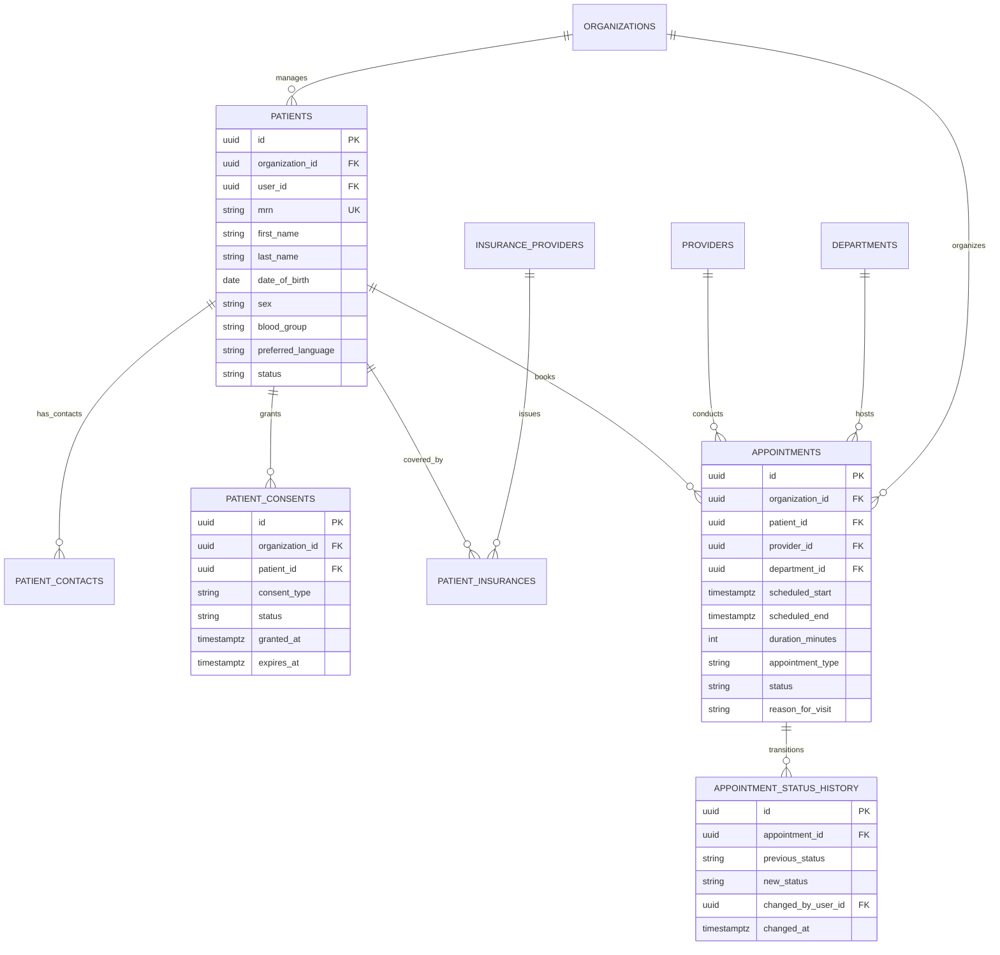
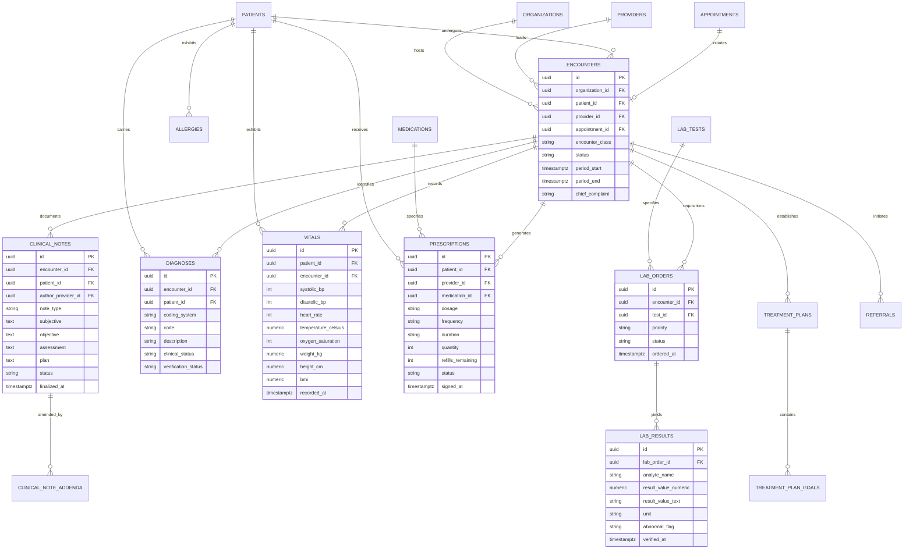
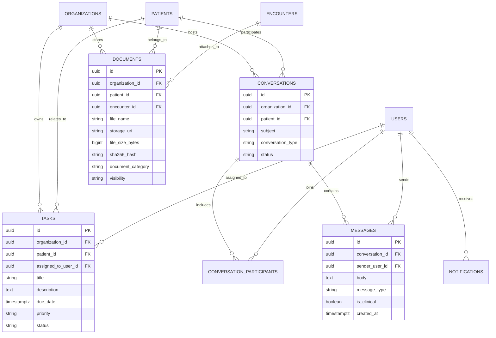
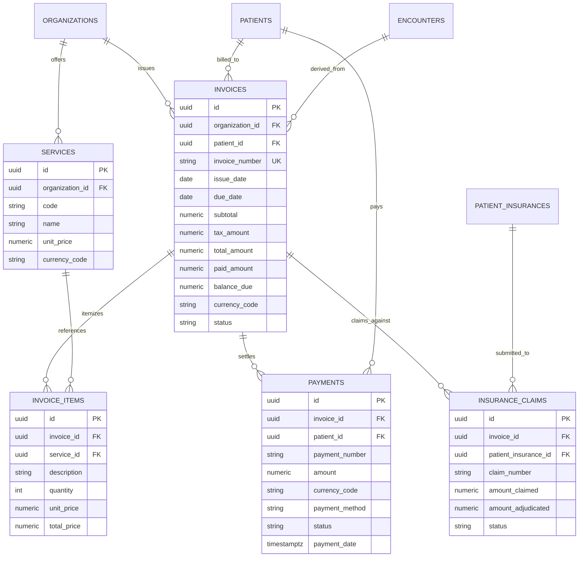

# CLINILYNC Entity Relationship Diagrams (ERD)

This document provides visual Mermaid Entity Relationship Diagrams (ERD) across all major functional domains of the CLINILYNC platform.

---

## 1. Identity, Tenancy & RBAC ERD

---

## 2. Patient 360 & Appointments ERD

---

## 3. Clinical Encounter & EMR Core ERD

---

## 4. Healthcare CRM, Communications & Tasks ERD

---

## 5. Billing, Payments & Insurance Claims ERD

