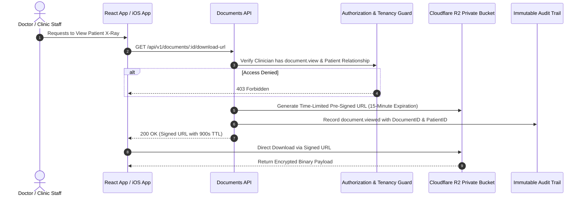

# CLINILYNC Security Architecture & Governance

## 1. Security Philosophy

In a global healthcare platform, security and data integrity override speed and convenience:
$$\text{SECURITY} > \text{SPEED} \qquad \text{DATA INTEGRITY} > \text{CONVENIENCE} \qquad \text{EXPLICIT AUTHORIZATION} > \text{TRUST}$$

---

## 2. Edge Defense & Security Headers

Cloudflare Workers terminate TLS 1.3 and inject mandatory defense-in-depth HTTP security headers on all responses:

```http
Strict-Transport-Security: max-age=63072000; includeSubDomains; preload
X-Content-Type-Options: nosniff
X-Frame-Options: DENY
Referrer-Policy: strict-origin-when-cross-origin
Permissions-Policy: camera=(), microphone=(), geolocation=()
Content-Security-Policy: default-src 'self'; script-src 'self'; style-src 'self' 'unsafe-inline'; img-src 'self' data: https:; font-src 'self' data:; connect-src 'self' https://api.clinilync.com;
```

- **X-Frame-Options `DENY`:** Prevents clickjacking attacks attempting to embed patient health records inside malicious iframes.
- **HSTS Preload:** Forces modern browsers to communicate strictly over encrypted HTTPS.
- **Cookie Security:** Session cookies use `HttpOnly`, `Secure`, and `SameSite=Strict`, blocking Cross-Site Scripting (XSS) and Cross-Site Request Forgery (CSRF).

---

## 3. Secure File & Document Storage Architecture

Medical scans, radiological imaging (DICOM), PDF lab reports, and signed consent records must never be stored as public blobs.



1. **Pre-Signed URLs:** Documents reside in private Cloudflare R2 buckets. Clients receive time-bounded pre-signed URLs valid for at most 15 minutes.
2. **SHA-256 Integrity Verification:** Document metadata stores the SHA-256 hash calculated during upload, preventing silent tampering.

---

## 4. Rate Limiting Strategy

Token-bucket rate limiting is enforced at the edge:
- **Authentication Endpoints (`/api/v1/auth/login`):** 5 requests per minute per IP address, with exponential backoff to prevent brute-force attacks.
- **Password Reset (`/api/v1/auth/password-reset`):** 3 requests per hour per email.
- **Standard API Endpoints:** 120 requests per minute per session token.
- **Search Endpoints:** 30 requests per minute per user to deter automated bulk data scraping.

---

## 5. Structured Application Logging vs Audit Logging

CLINILYNC strictly distinguishes between **Application Diagnostic Logs** and **Compliance Audit Logs**:

| Attribute | Application Logs (Datadog / Cloudflare Logs) | Immutable Audit Logs (`audit_logs` in PostgreSQL) |
| :--- | :--- | :--- |
| **Primary Audience** | DevOps & Site Reliability Engineers | Compliance Auditors, DPOs, Clinical Governance |
| **Content** | Request ID, HTTP status, execution latency, error codes | Actor ID, Organization ID, Action, Resource, Metadata diff |
| **Protected Health Info** | **STRICTLY FORBIDDEN** (Zero PHI, names, or diagnosis codes) | Identifies specific resources accessed with redacted secrets |
| **Retention** | 30 to 90 days rolling retention | **Permanent / 7+ Years** (Immutable, legally discoverable) |
| **Mutability** | Log stream rotated and purged | **Append-Only** (Triggers block `UPDATE` and `DELETE`) |
